# Tài liệu Kiến trúc CI/CD — SafeSpace SSFRMS

> **Dự án:** Hệ thống quản lý và cho thuê kho tự phục vụ SafeSpace (SSFRMS)  
> **Repository:** `ryocoding13/SSFRMS`  
> **Công nghệ:** .NET 10 Minimal API, React 19 + Vite Frontend, Microsoft SQL Server 2022, Docker Containers, GitHub Actions & GHCR.

---

## 1. Tổng quan Kiến trúc CI/CD

Quy trình CI/CD của SafeSpace SSFRMS được thiết kế theo chuẩn doanh nghiệp nhằm đảm bảo:
- **Zero Broken Build:** Mọi thay đổi mã nguồn trước khi merge vào `main` đều phải vượt qua cổng kiểm tra tự động (`ci-gate`).
- **Release Manifest & Digest Pinning:** Tuyệt đối không dùng tag `latest` để triển khai. Mọi môi trường Staging và Production đều chạy bằng exact SHA-256 digest (`@sha256:...`) trích xuất từ bản đóng gói đã vượt qua toàn bộ các bài kiểm thử.
- **Forward-Fix & Data Safety:** Không tự động hạ database schema (no EF Down); sao lưu database bắt buộc trước khi can thiệp schema; migrator chạy one-shot độc lập.
- **Controlled Production Promotion:** Không tự động deploy lên Production; chỉ Kỹ thuật viên được chỉ định mới có thể promote bản release đã vượt qua Staging, thông qua GitHub Environment với đầy đủ quyền phê duyệt (Required Reviewers) mà **không rebuild lại mã nguồn**.

```mermaid
graph TD
    subgraph "1. Local Development & Verification"
        DEV[Developer Code] --> INIT["./init.sh hoặc ./init.ps1"]
        INIT --> RUNCI["scripts/ci/run-ci.sh (.ps1)"]
        INIT --> RUNINT["scripts/ci/run-integration.sh (.ps1)"]
    end

    subgraph "2. Pull Request Gate (.github/workflows/ci.yml)"
        PR[Pull Request -> main] --> JOB_FE["Job: frontend (4 suites + build)"]
        PR --> JOB_BE["Job: backend (.NET 10 + 57 unit tests)"]
        PR --> JOB_INT["Job: integration-test (SQL 2022 + 9 tests)"]
        PR --> JOB_CONT["Job: container-build (API + Web + Migrator + Smoke)"]
        JOB_FE & JOB_BE & JOB_INT & JOB_CONT --> CIGATE{"Job: ci-gate (PASS 100%)"}
    end

    subgraph "3. Release & Staging CD (Push to main)"
        MERGE[Merge to main] --> PUBLISH["Job: publish-release (Push GHCR + Manifest)"]
        PUBLISH --> STG_GATE{"Gate: ENABLE_STAGING_DEPLOY"}
        STG_GATE -- true --> DEPLOY_STG["Job: deploy-staging (scripts/deploy/deploy.sh)"]
        STG_GATE -- false --> STG_STANDBY["Standby (Packages Ready in GHCR)"]
    end

    subgraph "4. Production Promotion (.github/workflows/deploy-production.yml)"
        DISPATCH["Manual: workflow_dispatch (release_sha)"] --> PROV_GATE["Validate SHA & Fetch Manifest from main"]
        PROV_GATE --> PROD_ENV{"Environment: production (Reviewers / Protection)"}
        PROD_ENV --> PROD_GATE{"Gate: ENABLE_PRODUCTION_DEPLOY"}
        PROD_GATE -- true --> DEPLOY_PROD["Job: deploy-production (scripts/deploy/promote-production.sh)"]
        PROD_GATE -- false --> PROD_STANDBY["Standby (Verified Manifest Stored)"]
    end
```



---

## 2. Chi tiết các luồng CI/CD

### 2.1. Luồng Pull Request và CI Gate (`.github/workflows/ci.yml`)

Mọi Pull Request gửi vào nhánh `main` hoặc các lần push trên nhánh feature đều kích hoạt workflow CI:

| Job | Môi trường / Runner | Nhiệm vụ chính |
|---|---|---|
| `frontend` | `ubuntu-latest` (Node 24) | - Cài đặt dependencies với `npm ci`<br>- Kiểm tra cấu trúc thư mục (`npm run check:structure`)<br>- Chạy unit tests nghiệp vụ `appReducer` (`npm test`)<br>- Chạy render tests giao diện (`npm run test:render`)<br>- Build bundle production (`npm run build`) |
| `backend` | `ubuntu-latest` (.NET 10.0.100) | - Restore dependencies với `global.json`<br>- Build cấu hình Release cho toàn bộ solution `StorageProject.slnx`<br>- Chạy 57 unit tests in-memory SQLite (`StorageProject.Tests`) |
| `integration-test` | `ubuntu-latest` + Service Container `mssql/server:2022-latest` | - Chạy SQL Server 2022 container với healthcheck readiness<br>- Kiểm tra toàn bộ 6 migrations EF Core lịch sử trên SQL Server thật<br>- Kiểm tra Zero Model Drift giữa C# entities và database snapshot<br>- Chạy 9 integration tests: đăng nhập 5 roles, RBAC 401/403, idempotency payment, `sp_getapplock` concurrency lock |
| `container-build` | `ubuntu-latest` | - Build Docker images cho API, Web và one-shot Migrator bundle<br>- Khởi động stack kiểm thử đóng gói bằng Docker Compose<br>- Thực thi bộ smoke test tự động `scripts/ci/smoke.sh` |
| `ci-gate` | `ubuntu-latest` | - Tổng hợp kết quả từ 4 jobs trên; chỉ pass khi cả 4 jobs thành công 100% |

### 2.2. Luồng Release và Triển khai Staging (Push vào nhánh `main`)

Khi một PR được merge vào `main` và `ci-gate` đạt trạng thái pass:
1. **Job `publish-release`:**
   - Đăng nhập vào GitHub Container Registry (`ghcr.io`).
   - Đóng gói và push 3 container images với tag ghim theo commit:
     - `ghcr.io/<repo>/api:sha-<commit>`
     - `ghcr.io/<repo>/web:sha-<commit>`
     - `ghcr.io/<repo>/migrator:sha-<commit>`
   - Trích xuất digest SHA-256 bất biến của từng image.
   - Sinh file **Release Manifest** ([deploy/release-manifest.schema.json](file:///d:/StorageProject/deploy/release-manifest.schema.json)) chứa: `commit`, `repository`, `runId`, `timestamp`, `migrationHead`, `images` (digest) và `gateResults`.
   - Lưu trữ Release Manifest thành workflow artifact (retention 30 ngày).
2. **Job `deploy-staging`:**
   - Tải artifact `release-manifest`.
   - Kiểm tra biến môi trường `ENABLE_STAGING_DEPLOY`:
     - Nếu `false` hoặc chưa đặt: Báo trạng thái **Standby** an toàn trên `$GITHUB_STEP_SUMMARY`, không báo lỗi giả.
     - Nếu `true`: Thực thi kịch bản [scripts/deploy/deploy.sh](file:///d:/StorageProject/scripts/deploy/deploy.sh) gồm 8 bước an toàn (lock môi trường, pull digest, backup DB, one-shot migrator, up services, readiness probe, smoke test, lưu `release-current.json`).

### 2.3. Luồng Promotion Production có kiểm soát (`.github/workflows/deploy-production.yml`)

Quy trình thăng hạng (promotion) lên môi trường Production được bảo vệ tuyệt đối:
1. **Kích hoạt thủ công:** Kỹ thuật viên kích hoạt `workflow_dispatch` và nhập mã `release_sha` (40 ký tự hex).
2. **Xác minh nguồn gốc (Provenance Validation):**
   - Workflow kiểm tra xem commit SHA đó đã có bản CI run thành công trên nhánh `main` hay chưa.
   - Tải và thẩm định Release Manifest: đảm bảo cả 4 gate checks đều là `success` và các image digest đều tuân thủ `sha256:[0-9a-f]{64}`.
3. **Environment Protection:**
   - Gắn với GitHub Environment `production`.
   - Áp dụng các quy tắc bảo vệ: Required Reviewers (cần ít nhất 1 thành viên cấp cao phê duyệt), Wait Timer, Deployment Branch Policy (chỉ `main`).
4. **Triển khai không Rebuild (Zero Rebuild):**
   - Sử dụng đúng exact digest đã qua Staging.
   - Thực thi kịch bản [scripts/deploy/promote-production.sh](file:///d:/StorageProject/scripts/deploy/promote-production.sh) gồm 9 bước:
     1. Khóa deploy production (`/tmp/safespace-prod-deploy.lock`).
     2. Xác thực manifest và digests.
     3. Kiểm tra an toàn cấu hình: cấm tuyệt đối `Database__SeedMode` khác `None`.
     4. Pre-pull images theo exact digest.
     5. Bắt buộc sao lưu database production ra ngoài volume (`/var/backups/safespace/prod/`); nếu backup lỗi thì **dừng ngay lập tức**.
     6. Dừng API/Web cũ, chạy one-shot migrator container; nếu migration lỗi thì **dừng ngay**.
     7. Khởi động API và Web containers mới.
     8. Chờ readiness probe `/health/ready` sẵn sàng (timeout 60s).
     9. Chạy bộ smoke test kiểm thử HTTP status, facilities API, SPA index và static assets; lưu trữ lịch sử release vào `deploy/releases/prod_<timestamp>_<sha>.json`.

---

## 3. Ma trận Cấu hình và Bí mật

### 3.1. Repository Variables (Không bí mật)

Cấu hình tại: **Settings > Secrets and variables > Actions > Variables**

| Tên biến | Kiểu | Mô tả |
|---|---|---|
| `ENABLE_STAGING_DEPLOY` | boolean (`true`/`false`) | Cổng bật tự động deploy lên môi trường Staging. Mặc định `false` (standby). |
| `ENABLE_PRODUCTION_DEPLOY` | boolean (`true`/`false`) | Cổng bật triển khai lên môi trường Production. Mặc định `false` (standby). |
| `STAGING_URL` | string URL | URL công khai của môi trường Staging (VD: `https://staging.safespace.vn`). |
| `PRODUCTION_URL` | string URL | URL công khai của môi trường Production (VD: `https://safespace.vn`). |

### 3.2. Environment Secrets (Bảo mật cao)

Cấu hình theo từng Environment (**Settings > Environments > staging / production**):

| Tên Secret | Mục đích sử dụng | Lưu ý bảo mật |
|---|---|---|
| `SA_PASSWORD` | Mật khẩu tài khoản `sa` của SQL Server | Tối thiểu 16 ký tự, gồm hoa, thường, số và ký tự đặc biệt |
| `DATABASE_CONNECTION_STRING` | Chuỗi kết nối SQL Server cho API & Migrator | Sử dụng thông tin người dùng riêng của ứng dụng, không dùng sa nếu có thể |
| `JWT_SECRET` | Khóa bí mật ký JWT Token | Tối thiểu 32 ký tự (256-bit), giữ ổn định qua các lần deploy |
| `ACCESS_QR_SECRET` | Khóa bí mật sinh mã QR mở cửa kho | Độc lập với JWT, không đổi để tránh vô hiệu hóa mã QR của khách |
| `PAYOS_CLIENT_ID` | Client ID kênh thanh toán PayOS | Lấy từ cổng đối tác PayOS |
| `PAYOS_API_KEY` | API Key thanh toán PayOS | Tuyệt đối không commit vào git repository |
| `PAYOS_CHECKSUM_KEY` | Khóa xác thực checksum giao dịch PayOS | Dùng để verify webhook thanh toán an toàn |

---

## 4. Công cụ Kiểm tra Cục bộ (Local Verification)

Trước khi commit hoặc push code, lập trình viên có thể chạy toàn bộ các bước kiểm tra cục bộ:

```bash
# Chạy toàn bộ kiểm tra môi trường, FE 4 suites, BE unit + integration tests:
./init.sh               # Linux / macOS / Git Bash
.\init.ps1              # Windows PowerShell

# Chạy riêng bộ CI script (tương đương GitHub Actions runner):
bash scripts/ci/run-ci.sh
powershell -ExecutionPolicy Bypass -File .\scripts\ci\run-ci.ps1

# Chạy riêng bộ SQL Server integration tests:
bash scripts/ci/run-integration.sh
powershell -ExecutionPolicy Bypass -File .\scripts\ci\run-integration.ps1

# Chạy thử nghiệm smoke test bản đóng gói:
bash scripts/ci/smoke.sh "http://localhost:8080"
powershell -ExecutionPolicy Bypass -File .\scripts\ci\smoke.ps1 -BaseUrl "http://localhost:8080"
```
